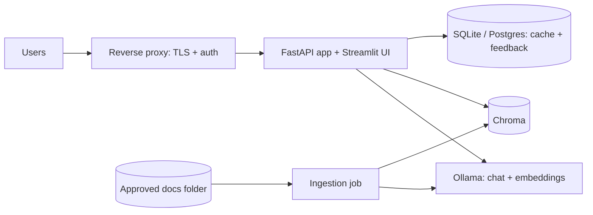
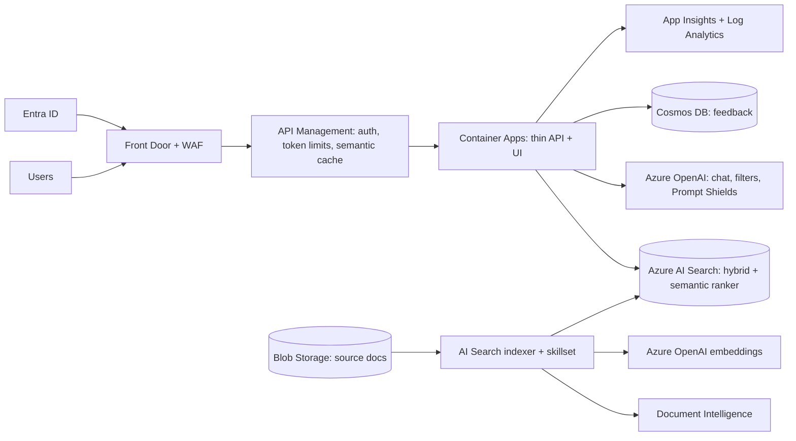
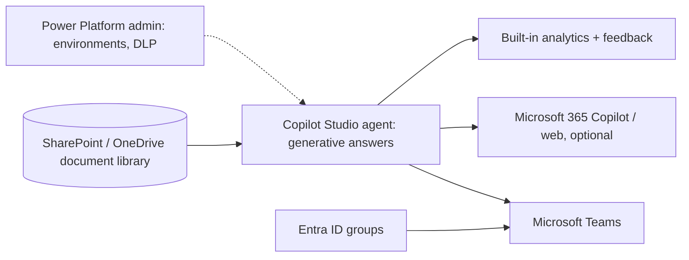
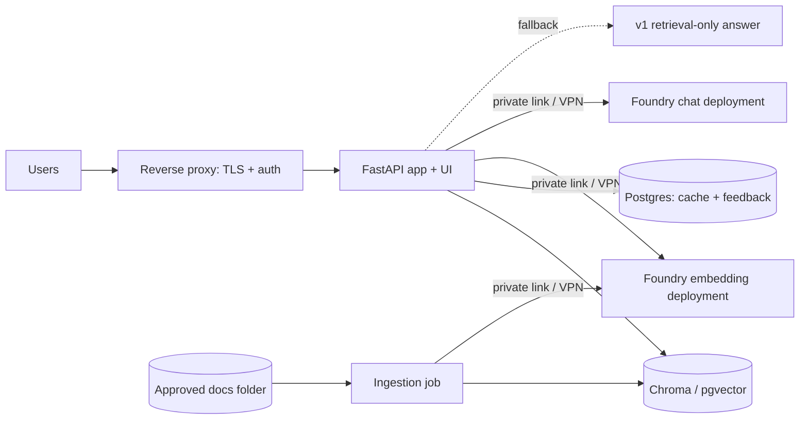

# Enhancement Options: Four Ways to Extend the Docs Q&A Assistant

The v1 engine ([SOLUTION_DESIGN.md](SOLUTION_DESIGN.md)) is retrieval-only and has no LLM. This document compares four ways to take it further and gives a detailed plan for each. It stands alone; the existing documents are unchanged.

## 1. The four options

| Option | Name | In one line |
|---|---|---|
| **A** | On-prem | Self-hosted pipeline end to end, with the LLM served locally (Ollama or equivalent). |
| **B** | Azure cloud-native | Managed Azure services do parsing, indexing, search, generation, safety and monitoring. We write a thin API and UI hosted in Azure. |
| **C** | Copilot Studio agent | A no-code/low-code agent grounded on a document source (such as SharePoint), published to Microsoft Teams for chosen user groups. |
| **D** | Hybrid | Documents, retrieval, app, cache and feedback stay on-prem. Only the chat and embedding models are called from Azure AI Foundry. |

### Brief descriptions

- **A: On-prem.** Open components we assemble: file loaders, Chroma for vectors, Ollama for chat and embeddings, FastAPI and Streamlit, Docker Compose. Nothing leaves the network.
- **B: Azure cloud-native.** Blob Storage holds the documents. An Azure AI Search indexer with integrated vectorization parses (via Document Intelligence), chunks, embeds and indexes them. Azure OpenAI generates grounded answers. Container Apps hosts the thin app, API Management adds limits and caching, Entra ID handles identity.
- **C: Copilot Studio.** An agent with the documents added as knowledge sources, answers restricted to those sources, published to Teams and shared with specific security groups. Almost no code.
- **D: Hybrid.** The v1 retrieval engine and a local vector store run on-prem as in A, but the local LLM is replaced by Azure AI Foundry deployments for chat and embeddings, reached over private connectivity.

## 2. When to use which

| If the situation is... | Choose |
|---|---|
| Data must never leave the network, or the site is air-gapped | **A** |
| The business wants a Teams-based document bot quickly, content is (or can be) in SharePoint, and moderate tuning is acceptable | **C** |
| The customer wants strong answer quality, scale, full control and testable "don't answer if not covered" behavior, and accepts cloud processing | **B** |
| Documents must stay on-prem, but sending text to Azure model endpoints is acceptable, and local model quality is not good enough | **D** |
| A quick pilot before a bigger decision | **C**, then move to B or D if control or testing needs grow |
| Strict, measurable abstention is a hard requirement | **A, B or D** (C offers limited control) |

## 3. Pros and cons across factors

Ratings: **High / Medium / Low** describe how well the option does on the factor (for cost and effort, Low is better for effort and ops burden).

| Factor | A: On-prem | B: Azure | C: Copilot Studio | D: Hybrid |
|---|---|---|---|---|
| **Data residency** | Best: all inside | Azure region of choice | Microsoft 365 tenant | Documents and index on-prem; chunk text sent to Azure for embeddings and answers |
| **Build effort** | High | Medium | Low | High |
| **Operations burden** | High | Low | Lowest | High |
| **Retrieval and chunk control** | Full | High | Low | Full |
| **Abstention control ("I don't know")** | Full (own threshold and checks) | High (score threshold and citation check) | Limited (toggle general knowledge off, tune settings; no tunable score threshold) | Full |
| **Answer quality** | Depends on local model; Medium | High | Medium to High, hard to tune | High |
| **Supported document sources** | Any local files | Blob Storage (any format Document Intelligence supports) | SharePoint, OneDrive, uploads, websites; a plain file share must be moved or synced | Any local files |
| **User interface and distribution** | We build it | We build it | Built in: Teams, Microsoft 365 Copilot, web; group-based sharing | We build it |
| **Feedback and analytics** | We build it | We build it | Built in (basic) | We build it |
| **Testing and evaluation** | Full scripted control | Full scripted control | Weaker; mostly through the test chat and limited tooling | Full scripted control |
| **Customization (cache, custom checks)** | Full | High | Low | Full |
| **Scalability** | Manual | Automatic | Managed | App is manual; models managed |
| **Security and identity** | Customer OIDC; we manage everything | Entra ID, Managed Identity, private endpoints | Entra ID, Microsoft 365 governance and sharing controls | On-prem controls plus secure connectivity and credentials for Azure calls |
| **Cost model** | Hardware and operations | Pay per use | Copilot Studio capacity or licence plus Microsoft 365 | Foundry tokens plus on-prem hardware and operations |
| **Offline resilience** | Works fully offline | Depends on Azure | Depends on Microsoft cloud | Falls back to v1 retrieval-only if Azure is unreachable |
| **Vendor lock-in** | Low | High | Highest | Medium |
| **Time to first value** | Slowest | Medium | Fastest | Slow to medium |

### Option summaries

**A: On-prem**
- Pros: full data control, no per-token cost, works offline, full control of behavior and tests.
- Cons: highest operations burden, model quality bounded by local hardware, manual scaling and availability.

**B: Azure cloud-native**
- Pros: very little custom code, strong models, automatic scaling, built-in safety, monitoring and identity, scripted tests possible.
- Cons: data processed in the cloud, usage costs, strong dependence on Azure features and quotas, grounding must still be verified on the labelled set.

**C: Copilot Studio**
- Pros: quickest to deliver, Teams and Microsoft 365 distribution, group-based access, built-in citations, feedback and analytics, little or no development.
- Cons: limited control of retrieval and abstention, harder to evaluate and regression-test, source must be reachable by the service, licence or capacity costs, limits on file formats and sizes.

**D: Hybrid**
- Pros: documents and index remain on-prem, hosted models improve quality, full retrieval and abstention control, graceful fallback to v1.
- Cons: "on-prem" does not mean text stays on-prem (chunks and questions go to Azure), WAN latency, two environments to operate, re-embedding needed if the embedding model changes.

## 4. Behavior requirements for every option

1. **Grounded or silent:** answers come only from the customer's documents; otherwise "I don't have an answer for that in the documentation."
2. **Decide before generating:** where the option allows it, a relevance check runs before any LLM call.
3. **Citations:** every answer shows its source document and page or section.
4. **Graceful failure:** if generation fails, show the best passage or a clear no-answer.
5. **Untrusted input:** questions and documents are untrusted; prompt injection is tested.
6. **Traceable, not leaky:** a trace ID per request; no raw questions or personal data in logs.
7. **One shared evaluation set:** at least 40 labelled questions (at least 10 unanswerable, plus synonym and injection cases), run against every option so results compare fairly.

## 5. Detailed plan: Option A, On-prem

### Architecture

### Components

| Layer | Choice | Notes |
|---|---|---|
| LLM serving | Ollama (alternatives: vLLM, llama.cpp server) | |
| Chat model | Instruction-tuned open model around 7-8B (e.g. Llama 3.1 8B, Qwen 2.5 7B) | Choose by evaluation |
| Embeddings | `nomic-embed-text` or `bge-m3` via Ollama | |
| Parsing | `pypdf`, `python-docx`, Markdown and text readers | Weaker on scans and tables |
| Vector store | Chroma | pgvector or Qdrant for scale or HA |
| Retrieval | Hybrid: v1 lexical engine plus vector similarity | Keeps the coverage check |
| Cache and feedback | SQLite, then Postgres | |
| Packaging | Docker Compose | Pinned versions |
| Auth and TLS | Customer OIDC provider; Caddy or Nginx | |

### Steps

| Step | Task | Done when |
|---|---|---|
| A1 | Multi-format loaders and a heading/paragraph chunker that keeps file and page/section | Each format tested, including corrupt and oversized files |
| A2 | Ollama chat and embedding clients with timeouts, retries, token cap | Failures handled safely |
| A3 | Chroma ingestion: upsert by document ID and content hash, delete on change | Only changed documents re-embedded |
| A4 | Hybrid retrieval and recalibrated relevance threshold | Synonym test passes; abstention measured |
| A5 | Answer prompt (passages only) and fact check against passages | Unsupported facts fall back to the verbatim passage |
| A6 | Response cache keyed by normalized question and document-set version | Edited document invalidates dependent entries |
| A7 | FastAPI: `/ask`, `/feedback`, `/health`, size and rate limits | OpenAPI doc and tests |
| A8 | Streamlit UI with citations and thumbs up/down | Usable by the support team |
| A9 | Docker Compose, reverse proxy, TLS and OIDC | One-command start on a clean machine |
| A10 | Model selection: evaluate 2-3 candidate chat and embedding models | Table of accuracy, abstention, latency, memory |
| A11 | Operations: backups, log rotation, health checks, upgrade runbook | Documented |

### Security checklist

- No outbound access needed at runtime; model files pre-downloaded with recorded checksums.
- Ollama and Chroma reachable on the internal network only.
- Authentication at the edge; per-user rate limits.
- Prompt-injection and system-prompt-leak tests.
- Secrets in environment variables or a local secret store, never in the repo.
- Patch plan for OS, containers and model server; backups tested.

### Risks

| Risk | Mitigation |
|---|---|
| Small models drift from the passages | Strict prompt, fact check, verbatim fallback, model evaluation |
| GPU or memory shortfall | Measure early (A10); smaller model; cache |
| No managed high availability | Start single node; plan replicated Postgres and a second app node |
| Model license changes | Pin versions; check licenses |

## 6. Detailed plan: Option B, Azure cloud-native

### Design stance

Use the managed service for each capability, and write only thin glue code.

| Capability | Managed Azure service |
|---|---|
| Parsing (PDF, Word, scans, tables) | Azure AI Document Intelligence, via Azure AI Search skills |
| Chunking and embeddings at ingestion | Azure AI Search integrated vectorization |
| Keeping the index current | Azure AI Search indexer on Blob Storage with change and delete detection |
| Search | Azure AI Search hybrid (keyword + vector) with the semantic ranker |
| Generation and citations | Azure OpenAI (On Your Data, or a Foundry agent using the AI Search tool) |
| Safety | Content filters and Prompt Shields |
| Rate and token limits | API Management policies |
| Semantic cache | API Management semantic-caching policies with Azure Cache for Redis |
| Identity | Entra ID and Managed Identity |
| Hosting | Azure Container Apps (or App Service) |
| Monitoring | Application Insights and Log Analytics |

### Architecture

### Keeping "answer only from the docs"

1. The app queries Azure AI Search (hybrid with the semantic ranker).
2. It checks the top reranker score against a threshold tuned on the labelled set. Below it, return the no-answer message and **do not call the LLM**.
3. Above it, generate with the answer restricted to indexed content and high strictness, returning citations.
4. Discard any answer without citations and return the no-answer message.

Grounding settings reduce but do not eliminate off-document answers; the threshold and citation requirement must be verified on the labelled set.

### Steps

| Step | Task | Done when |
|---|---|---|
| B1 | Decide subscription, region, environments and residency needs | Written decision |
| B2 | Bicep or `azd` for Storage, AI Search, Azure OpenAI deployments, Container Apps, registry, Cosmos DB, API Management, Redis, Key Vault, monitoring, role assignments | One command provisions dev |
| B3 | Index design: chunk fields, vector field, vector profile and vectorizer, semantic configuration | Index defined in code |
| B4 | Skillset and indexer: layout parsing, text split, embedding, index projections, change and delete detection, schedule | Add, edit or delete a blob updates the index with no custom code |
| B5 | Thin API: validation, hybrid query, score threshold, grounded call, citation check, trace ID | Behavior requirements pass on the labelled set |
| B6 | UI with citations and feedback saved to Cosmos DB with the trace ID | Support team can review feedback |
| B7 | Entra ID sign-in; Managed Identity and role-based access between services | No keys in code or config |
| B8 | API Management: per-user rate limits, token limits, semantic caching | Repeated questions skip the model; quota stops runaway use |
| B9 | CI/CD with GitHub Actions and OIDC federation; tests, image scan, dev deploy, approved promotion | No stored cloud secrets |
| B10 | Dashboards and alerts: latency, no-answer rate, token use, cost, errors, 429s | Alerts defined in IaC |
| B11 | Private endpoints and a VNet-integrated environment if required | Data services not reachable from the internet |
| B12 | Run the shared evaluation set including injection cases | Scorecard comparable with other options |

### Security checklist

- Managed Identity and role-based access instead of keys; Key Vault for anything that must remain a secret.
- Least-privilege roles per environment; public access disabled where possible.
- WAF rules, request limits, rate limits at the edge.
- Content filters, Prompt Shields, and our own injection tests.
- Blob soft delete and versioning; deliberate log retention; no raw questions in logs.
- Image scanning and pinned base images in CI.
- Customer review of region, cloud processing and Azure OpenAI abuse-monitoring settings before go-live.

### Cost levers

Relevance check before any LLM call; API Management semantic cache; a small chat model with few passages and an output cap; indexer reprocesses only changed blobs; scale-to-zero in dev and test; right-sized AI Search tier.

### Risks

| Risk | Mitigation |
|---|---|
| Managed grounding still produces off-document text | Score threshold, citation requirement, labelled evaluation |
| Azure OpenAI quota or regional availability | Request quota early; choose suitable regions; handle 429s with retry and a passage fallback |
| Cost surprises | Budgets, alerts, token limits, cache, per-user quotas |
| Service features change | Confirm the recommended grounding option in B1; keep generation in one small module |
| Prompt injection through documents | Prompt Shields, injection tests, citation requirement |

## 7. Detailed plan: Option C, Copilot Studio agent in Teams

### Design stance

Configuration, not code. The agent answers from the document source and is published to Teams for specific groups.

### Architecture

### Steps

| Step | Task | Done when |
|---|---|---|
| C1 | Confirm licensing and capacity, and choose or create a Power Platform environment (dev, then prod) | Access and capacity confirmed |
| C2 | Prepare the content: put the documents in a SharePoint library with a clean folder structure, supported formats and correct permissions; remove outdated files | A single, curated source library |
| C3 | Create the agent with a clear name, description and instructions: answer only from the knowledge sources, cite sources, and give a fixed "I don't have an answer for that in the documentation" reply | Instructions saved |
| C4 | Add the library as a knowledge source; turn off the use of the model's general knowledge; set content moderation as strict as practical | Agent answers only from the library in test |
| C5 | Handle gaps: configure the fallback behavior, add a hand-off to a human or a support link for unanswered questions | Unanswered questions get the standard message and a next step |
| C6 | Test with the shared labelled set through the test chat; record answers, citations and misses; compare with the other options | Scorecard recorded; unanswerable questions do not receive made-up answers |
| C7 | Set security: authentication with Entra ID, sharing only with chosen security groups, data loss prevention policies, sensitivity labels, confirm that SharePoint permissions are respected for each user | Only intended groups can use the agent; restricted documents not exposed |
| C8 | Publish to the Teams channel; have a Teams admin approve it; pin it for the target groups | Visible and usable for the intended groups |
| C9 | Feedback and monitoring: review built-in analytics and thumbs up/down; schedule a review of unanswered and low-rated questions; maintain the library | Review routine established |
| C10 | Lifecycle: use solutions and environments (dev, test, prod) for changes and controlled release | Repeatable release process |

### Security checklist

- Entra ID authentication and group-based sharing; no anonymous access.
- Content permissions respected per user; sensitive libraries excluded or labelled.
- Data loss prevention policies in the environment; admin approval for Teams publishing.
- Review what data the service processes and retains for your tenant and region.

### Limits to know before choosing C

- The source must be something the service can read (typically SharePoint, OneDrive, uploads or websites); a plain on-prem file share needs to be moved or synced.
- No tunable relevance threshold or custom grounding check; rely on settings and testing.
- Evaluation is mostly manual through the UI; plan for periodic spot checks.
- Check file format and size limits, and licence or capacity cost at expected usage.

### Risks

| Risk | Mitigation |
|---|---|
| Answers not strictly limited to the documents | Turn off general knowledge, strict instructions, labelled-set testing, regular review |
| Hard to regression-test after changes | Keep the labelled set and re-run it after each content or configuration change |
| Poor source content (duplicates, stale files) | Curate the library, assign an owner, remove outdated versions |
| Cost grows with usage | Monitor capacity, set alerts, limit audience |

## 8. Detailed plan: Option D, Hybrid (on-prem retrieval, Foundry models)

### Design stance

Keep everything on-prem except model inference. The vector index, documents, cache, feedback, API and UI stay local; Azure AI Foundry deployments provide the chat and embedding models.

### Important data-flow fact

"Rest remains on-prem" does not mean text stays on-prem:

- **Ingestion:** every document chunk is sent to the Foundry embedding deployment.
- **Queries:** each question is sent for embedding, and the question plus the top passages are sent to the chat deployment.
- Only the stored vectors, the documents, the cache and the logs remain local.

Confirm with the customer that this flow, and the provider's data-handling terms, are acceptable.

### Architecture

### Components

| Layer | Choice |
|---|---|
| Documents, parsing, chunking | On-prem loaders and chunker (as Option A) |
| Embeddings | Azure AI Foundry embedding deployment |
| Chat model | Azure AI Foundry chat deployment |
| Vector store | Chroma or pgvector on-prem |
| Retrieval | Hybrid with the v1 lexical engine and the coverage check |
| Cache, feedback | Postgres on-prem |
| App, UI | FastAPI and Streamlit |
| Connectivity | Site-to-site VPN or ExpressRoute, with private endpoints for the Foundry resource; firewall allow-list for the Foundry endpoints only |
| Credentials to Azure | Microsoft Entra service principal with a certificate (or workload identity, or Azure Arc managed identity if the servers are Arc-enabled), kept in an on-prem secret store; avoid long-lived API keys |

### Steps

| Step | Task | Done when |
|---|---|---|
| D1 | Data classification and approval: which documents may be sent to Azure models; decide on redaction of sensitive content before sending | Written approval and scope |
| D2 | Network design: VPN or ExpressRoute, private endpoints, egress firewall allow-list, DNS | Only the Foundry endpoints reachable from the app and ingestion hosts |
| D3 | Foundry setup: project, chat and embedding deployments in the approved region or data zone, content filters, quotas, budgets | Deployments reachable from on-prem |
| D4 | Credential design: service principal with certificate or workload identity, least-privilege role, rotation plan | No API keys in code or config |
| D5 | On-prem stack from Option A without Ollama: loaders, chunker, Chroma or pgvector, Postgres, FastAPI, UI, Docker Compose | Stack runs end to end with a stub model client |
| D6 | Embedding client: batching, retries, 429 handling; store the embedding model name and dimension with each chunk | Ingestion works; model change detectable |
| D7 | Chat client: timeouts, token cap, passage-only prompt, citation and fact check, standard no-answer reply | Grounded answers with citations |
| D8 | Minimize what is sent: only the top passages and the sanitized question; optional redaction step | Verified by inspecting outbound request logs in test |
| D9 | Fallback and resilience: if Azure is unreachable or rate-limited, return the best verbatim passage (v1 behavior) or no-answer | Simulated outage yields a passage, not an error |
| D10 | Response cache with document-set and model-version keys to cut tokens | Repeated questions skip the model |
| D11 | Observability: trace ID, hashed questions, token counts, latency, Azure error rates; budget alerts in Azure | Dashboard and alerts |
| D12 | Run the shared evaluation set including injection cases; compare with A, B, C | Scorecard comparable |

### Security checklist

- Data-classification sign-off and documented data flow for what is sent to Azure.
- Private connectivity; egress limited to the Foundry endpoints.
- Certificate or workload-identity credentials, rotated; no keys in the repo.
- Prompt Shields and content filters enabled; our own injection tests.
- Logs without raw questions or full prompts; outbound request logging in test only, with sanitized content.
- Review the provider's data-use, retention and abuse-monitoring terms before go-live.

### Risks

| Risk | Mitigation |
|---|---|
| Sensitive text sent to Azure | Classification, redaction, scope limits, customer sign-off |
| WAN latency or outage | Timeouts, cache, v1 fallback |
| Changing the embedding model forces re-embedding | Store model name and dimension; plan a re-index procedure |
| Two environments to operate | Clear runbook; automation for deployment and updates |
| Token cost | Relevance check before generation, cache, small passage count, output cap |

## 9. Recommended sequence

1. Build the shared labelled evaluation set and injection tests first; they serve every option.
2. If the content is already in SharePoint, pilot **Option C** to prove value cheaply and gather real questions.
3. Choose between **B** (cloud) and **D** (hybrid) based on the data-residency decision, and use **A** where nothing may leave the network.
4. Run the same evaluation on every option actually built and compare accuracy, correct-abstention rate, citation correctness, latency, cost and effort.

## 10. Decisions needed from the customer

1. May document text leave the network, and in which form (embedding only, answers, or both)?
2. Where do the documents live today (file share, SharePoint, other)?
3. Is Microsoft Teams the preferred channel, and which user groups should have access?
4. Azure region and any compliance or residency rules.
5. Document volume, formats and update frequency.
6. Expected users and requests per day.
7. Hardware available on-prem (GPU or CPU only).
8. Budget and licensing position (Azure, Copilot Studio, Microsoft 365).
9. Accepted latency and answer-quality targets, and how strict "don't answer if not covered" must be.

## 11. Items to verify before committing

- Copilot Studio: current knowledge-source types, file and size limits, the setting that restricts answers to your sources, evaluation tooling, licensing and capacity pricing, and whether on-prem sources can be reached in your tenant.
- Azure OpenAI and Foundry: current recommended grounding option, regional availability and quotas, data-zone and private-networking support, and data-handling terms.
- Azure AI Search: skill availability per region (layout parsing, integrated vectorization) and the required tier.
- API Management: exact semantic-cache and token-limit policy names and requirements.
- Ollama: model names and licenses; sizing figures are starting points to confirm by measurement.
